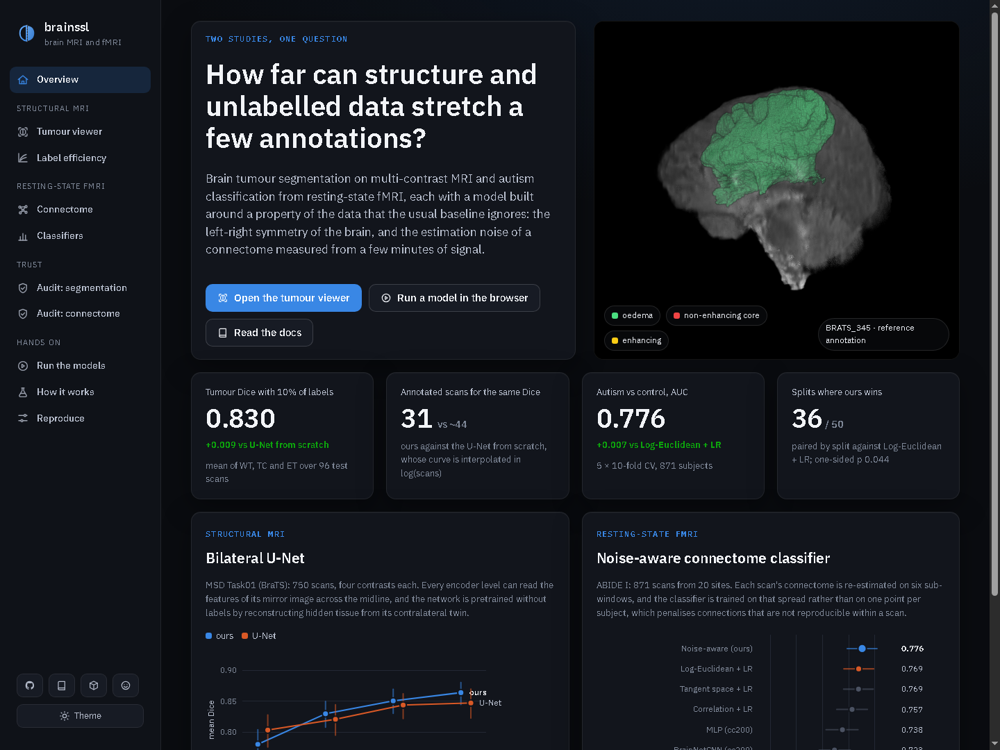

# brainssl

[](https://github.com/mahdisabetkish/brainssl/actions/workflows/ci.yml)
[](https://github.com/mahdisabetkish/brainssl/actions/workflows/nextflow.yml)
[](https://github.com/mahdisabetkish/brainssl/actions/workflows/rust.yml)
[](https://mahdisabetkish.github.io/brainssl/)
[](https://hub.docker.com/r/mahdisabetkish/brainssl)
[](https://huggingface.co/mahdisabetkish)
[](LICENSE)

Label-efficient learning on brain MRI and resting-state fMRI. The repository
holds two studies on public data that ask the same question from two sides:
what does a model gain from a property of the data that the standard baseline
ignores, when annotations are few or the measurements are noisy?

- **Structural MRI.** Brain tumour segmentation on four-contrast MRI (MSD
  Task01, the BraTS 2016/17 scans). A 3D U-Net in which every encoder level can
  compare a voxel with its mirror image across the midline, pretrained without
  labels by reconstructing hidden tissue from its contralateral twin.
- **Resting-state fMRI.** Autism versus control from functional connectomes
  (ABIDE I, 871 scans from 20 sites). A linear classifier trained on each scan's
  own estimation noise, measured by re-estimating the connectome on windows of
  the scan, instead of on one matrix per subject.

**[Interactive dashboard](https://mahdisabetkish.github.io/brainssl/)** ·
**[Documentation](https://mahdisabetkish.github.io/brainssl/docs/)** ·
[Models on Hugging Face](https://huggingface.co/mahdisabetkish) ·
[Docker images](https://hub.docker.com/r/mahdisabetkish/brainssl)

[](https://mahdisabetkish.github.io/brainssl/)

## Results

### Tumour segmentation: the more labels, the larger the gain

Dice on 96 held-out scans, mean of whole tumour, core and enhancing tumour. The
baseline is the same U-Net trained from scratch on the same scans.

| Labelled scans | Ours | U-Net from scratch | Difference [95% CI] | p |
|---|---|---|---|---|
| 310 (100%) | **0.864** | 0.847 | **+0.017** [+0.006, +0.031] | < 0.001 |
| 78 (25%) | **0.850** | 0.844 | +0.007 [-0.002, +0.015] | 0.010 |
| 31 (10%) | **0.830** | 0.821 | +0.009 [-0.002, +0.020] | 0.190 |
| 16 (5%) | 0.780 | 0.803 | -0.023 [-0.044, -0.003] | 1.000 |

- **With all labels, ours is better on every region and every distance.** Dice
  0.899 / 0.853 / 0.840 against 0.889 / 0.837 / 0.816 for whole tumour, core and
  enhancing tumour, each significant, and the 95th-percentile Hausdorff distance
  of the enhancing tumour falls from 11.3 to 7.2 mm. Ours is better on 65 of the
  96 scans.
- **With 10% of the labels, ours matches what the baseline needs about 44 scans
  for using 31.** The whole tumour is significantly better (+0.013, p = 0.010)
  and its boundary error drops from 15.3 to 9.7 mm.
- **Missing contrasts hurt the baseline far more.** With T2 removed, ours loses
  0.028 Dice and the baseline 0.129; with FLAIR removed, 0.46 against 0.75 (both
  p < 0.001, 10% labels). Both models are equally unaffected by image noise.
- **The network does use the mirror image.** Blocking it drops Dice from 0.84 to
  0.40, and left-right asymmetry alone finds the tumour with AUC 0.85 to 0.88.
- **Its uncertainty tells you which scans to check.** Entropy against error has
  Spearman 0.71 to 0.81 over the three regions, and whole-tumour volumes agree
  with the reference at r = 0.96.

The one place where ours loses is the smallest budget (16 scans), where the
baseline is better by 0.023. The pretraining gives a good start, but with so few
labels it is not enough, and the table keeps that row. Everything is in
[docs/results.md](docs/results.md) and the [trust results](docs/trust_results.md).

### Autism versus control: best of seven models

AUC over 5 repeats of 10-fold cross-validation on 871 subjects from 20 sites.

| Model | AUC [95% CI] |
|---|---|
| **Noise-aware (ours)** | **0.776** [0.747, 0.804] |
| Log-Euclidean + logistic regression (strongest baseline) | 0.769 [0.741, 0.798] |
| Tangent space + logistic regression | 0.769 [0.740, 0.797] |
| Correlation + logistic regression | 0.757 [0.727, 0.786] |
| MLP (cc200) | 0.738 [0.707, 0.768] |
| BrainNetCNN (cc200) | 0.723 [0.693, 0.753] |
| Brain Network Transformer (cc200) | 0.646 [0.620, 0.672] |

- **Ours has the highest AUC and wins 36 of 50 splits against the strongest
  baseline** (corrected resampled t-test p = 0.044). It is 4 to 13 AUC points
  above the three neural networks.
- **The score is not a shortcut.** Classifiers that see only the site or only the
  head motion reach 0.57 and 0.59; ours gets 0.80 when scored inside sites, and
  holds at 0.77 inside motion terciles.
- **Probabilities can be trusted after a cheap fix.** The raw outputs are
  too timid (calibration slope 2.4); a map fitted on other folds only brings the
  slope to 0.99 and the calibration error from 0.098 to 0.041.
- **The most confident half of the subjects is classified at 0.80 accuracy**
  against 0.70 for all of them, so the model knows which cases to leave out.
- **The explanation is faithful.** Deleting the 5% of features that the model
  names as most supportive takes the AUC from 0.72 to 0.38; deleting random
  ones leaves it at 0.72.

The differences among the three linear connectome models are small, as they are
in the literature on this dataset, and the table says so with the intervals.

All numbers are produced by `brainssl report` and `brainssl trust` from the run
directories. The full tables, with HD95 and every atlas, are in
[docs/results.md](docs/results.md).

## The two ideas

**Bilateral exchange.** Scans are cropped symmetrically about each brain's
mid-sagittal plane, which the preprocessing estimates by cross-correlating the
brain mask with its mirror image. Reflection across the midline is then a flip
of one axis at every resolution, and one extra block per encoder level computes
`f + g([f, Rf, |f - Rf|])`: each voxel reads its mirror image and decides what to
make of the difference. The last layer of `g` starts at zero, so the untrained
network is exactly the baseline U-Net. Pretraining hides one cube of every
mirror pair (`mask(Rx) = 1 - mask(x)`), so every hidden cube has a visible twin,
and reconstruction becomes a question of how one hemisphere predicts the other.
Tumours are where that prediction fails.
[Details and derivation](docs/methods/smri.md).

**Training on the scan's own noise.** A connectome estimated from a few minutes
of signal is noisy, and the noise is not the same in every direction. Six
overlapping windows of each scan give six further estimates scattered the way
repeated short acquisitions would be. The classifier is trained on that scatter,
which is vicinal risk minimisation with the vicinity estimated from the data; to
second order it adds a penalty `w' S w` that is large exactly along the
connectivity patterns that are not reproducible within a scan. Predictions are
averaged over the same windows, and the intercept is refitted for that rule on
the training subjects. [Details and derivation](docs/methods/fmri.md).

## How the comparison was kept fair

- The MRI test set (96 scans) and the label budgets were fixed with a seed before
  any training; budgets are nested, and every run of one budget shares the
  backbone, data pipeline, augmentation and number of steps.
- The regularisation strength of the noise-aware classifier was chosen on
  development splits (seeds 0 to 2) and written to
  [`assets/fmri_choices.json`](assets/fmri_choices.json) before the reported
  splits (seeds 10 to 14) were analysed.
- Every connectome baseline is credited with the regularisation that does best
  on the reported splits themselves, which can only flatter the baselines.
- MRI models are compared scan by scan (bootstrap interval, Wilcoxon test),
  connectome models split by split with the corrected resampled t-test of Nadeau
  and Bengio, which accounts for overlapping training sets.

The [evaluation protocol](docs/protocol.md) has the details.

## Running it

The whole study, from download to the dashboard data, is one Nextflow pipeline.
It runs locally, in Docker or Apptainer, or on a Slurm cluster:

```bash
nextflow run mahdisabetkish/brainssl -profile docker,gpu            # about 9.5 GB of data
nextflow run mahdisabetkish/brainssl -profile test,docker           # synthetic data, a few minutes on a CPU
```

Or step by step, with Python 3.10 to 3.12:

```bash
pip install torch==2.7.1 --index-url https://download.pytorch.org/whl/cu126
pip install -r requirements-lock.txt && pip install -e .

brainssl download msd && brainssl download abide
brainssl prepare msd && brainssl prepare abide
python scripts/run_smri.py                     # segmentation runs, resumable
brainssl fmri study --scheme kfold             # linear connectome models, every atlas and split
brainssl fmri study --scheme loso
python scripts/run_fmri.py                     # deep connectome baselines
brainssl report && brainssl export all && brainssl dashboard
```

The numbers above were produced on one GTX 1080 Ti (11 GB). Segmentation
training needs about 5 GB of GPU memory; the connectome study runs on the CPU.
[Reproduction notes](docs/reproduce.md).

## Inference without Python

`rust/` builds `brainssl-infer`, one binary for both models on ONNX Runtime. It
reimplements the preprocessing around each network (midline search, symmetric
crop, sliding windows and mirror averaging; Ledoit-Wolf, matrix logarithm and
window averaging) and is checked against the Python pipeline in CI.

```bash
brainssl-infer segment  --model exports/segmentation --input scan.nii.gz --output scan_seg.nii.gz
brainssl-infer classify --model exports/connectome --timeseries sub_rois_cc200.1D --atlas cc200
docker run --rm -v "$PWD:/data" mahdisabetkish/brainssl-infer segment --model /models/segmentation \
    --input /data/scan.nii.gz --output /data/scan_seg.nii.gz
```

The dashboard runs the connectome classifier in the browser, in plain
JavaScript, and the segmentation network through ONNX Runtime Web.

## Repository layout

```
src/brainssl/      data download, MRI and fMRI pipelines, statistics, export, report, dashboard data
rust/              brainssl-infer (Rust, ONNX Runtime)
dashboard/         the static site published on GitHub Pages
main.nf, modules/, conf/
                   the Nextflow pipeline
assets/            run matrices, pre-registered choices, showcase scans
docs/              documentation (MkDocs), including primers on MRI and fMRI
tests/             unit tests
```

## Data and licences

The code is MIT licensed. The MRI data come from the Medical Segmentation
Decathlon (CC BY-SA 4.0), the fMRI data from the ABIDE Preprocessed initiative
(CC BY-NC-SA); the trained models carry the licence of their training data.
Neither dataset is redistributed here; `brainssl download` fetches both from
their public hosts.

## Citation

If this repository is useful in your work, please cite it with the metadata in
[CITATION.cff](CITATION.cff).
